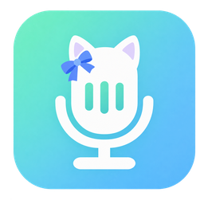
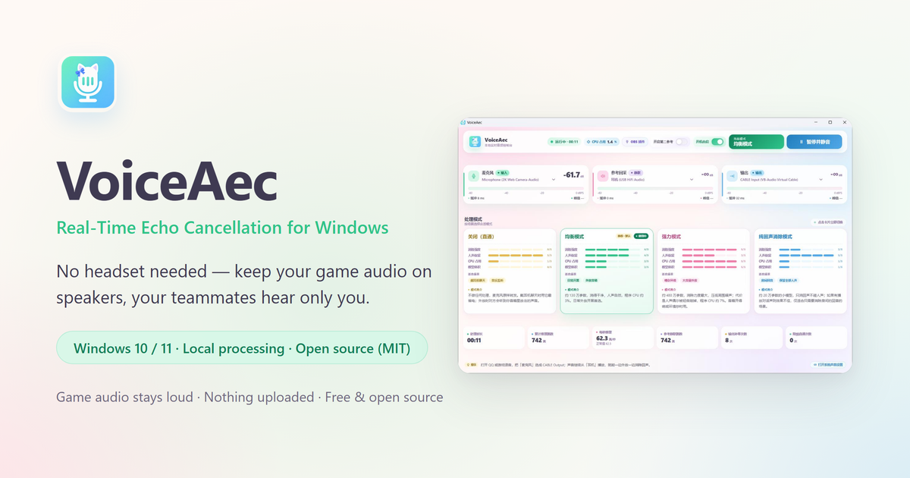

<div align="center">



<h1>VoiceAec</h1>

<p><b>Clear voice chat without a headset.</b></p>

<p>Real-time acoustic echo cancellation (AEC) for Windows: your game audio keeps playing out loud,<br>
and VoiceAec removes it from your microphone locally — teammates hear you, not your speakers.</p>

<p>
  <a href="https://github.com/384615666/VoiceAec/releases/latest"></a>
  <a href="https://github.com/384615666/VoiceAec/releases"></a>
  <a href="LICENSE"></a>
  
  
  <a href="https://voiceaec.lsjx.xyz/"></a>
</p>

<p>
  <a href="https://voiceaec.lsjx.xyz/">🌐 Website</a> ·
  <a href="https://voiceaec.lsjx.xyz/manual.html">📖 Manual</a> ·
  <a href="https://github.com/384615666/VoiceAec/releases/latest">⬇️ Download</a> ·
  <a href="https://github.com/384615666/VoiceAec/issues">💬 Issues</a> ·
  <a href="README.md">简体中文</a>
</p>

</div>

<p align="center">
  
</p>

## What it does

When you play games with speakers, your microphone picks up the game audio as well — your teammates end up hearing a second-hand mix of gunfire, music and notifications. Put on a headset or mute the game, normally.

VoiceAec performs neural acoustic echo cancellation locally: the current playback device is looped back as a reference signal, the neural network subtracts it from your microphone, and the cleaned voice is written to a VB-CABLE virtual audio device. Voice apps such as QQ, Oopz, Discord or in-game chat simply use `CABLE Output` as their microphone.

- 🎧 **No headset required** — game audio stays on your speakers, echo disappears from voice chat
- 🔒 **Fully local** — the model runs on your own CPU; no cloud, no audio uploads
- 📦 **Self-contained** — the installer bundles the .NET runtime and all models; devices are auto-selected on first launch
- 🎛 **Two flavors** — a desktop control panel and a one-click OBS audio filter

## Highlights

<!-- Keep this list aligned with the Chinese README (功能一览). -->

| Feature | Description |
| --- | --- |
| Three level meters | Microphone / reference loopback / output, -60 to 0 dBFS with peak hold |
| Four hot-switchable modes | OFF, Balanced v1.2, Aggressive v1.3, Echo-only v1.4 — remembered across launches |
| Second reference (advanced) | Optional second microphone near a noise source to suppress nearby conversations |
| Automatic device setup | Default communications mic, default playback device and `CABLE Input` are picked automatically |
| Device-loss fallback | If a saved device disappears, VoiceAec falls back to system default without overwriting your choice |
| Pause & mute | Stops capture, inference and output; restores cleanly on resume |
| Tray-first desktop app | Closing the window keeps audio running; the tray menu handles modes, autostart and exit |
| LAN panel | Open the LAN URL shown in About (default `http://192.168.x.x:8765/`; the port shifts when 8765 is busy) from a phone on the same Wi-Fi — click the address to copy it; disable with `--no-lan` |
| Bilingual UI | Switch the whole interface between Chinese and English from the About dialog (top-right, next to Close); the choice is remembered and applies to the panel, tray menu and messages. |
| Frameless window | Custom minimize / maximize / close buttons inside the panel; drag the top strip, double-click to maximize, resize from any edge; maximizing stays on the current monitor and closing hides to the tray. |
| One-click OBS plugin | Install / uninstall the OBS audio filter from the panel, with backup and rollback |
| Local HTTP API | `http://localhost:8765`; loopback always allowed, private-LAN peers allowed only while the LAN panel is enabled; `X-VoiceAec-Token` required for `/api/*` |

## Quick start

1. **Download** the latest `VoiceAec-v*-setup-x64.exe` (recommended) or the portable `VoiceAec-v*-win-x64.zip` from [Releases](https://github.com/384615666/VoiceAec/releases/latest). The installer is per-user and self-contained (no separate .NET runtime, all models included); only the optional VB-CABLE and LAN-panel setup requests administrator rights once.
2. **Install VB-CABLE** (free virtual audio device). The installer offers it by default; the portable build shows a one-click install banner on first launch. **Reboot** afterwards so `CABLE Input` / `CABLE Output` appear.
3. **Match the devices**:

   | Where | Choose |
   | --- | --- |
   | Windows playback (game / music) | Your speakers or headphones |
   | VoiceAec · reference loopback | The playback device that is actually making sound (auto-selected) |
   | VoiceAec · output | `CABLE Input` (auto-selected) |
   | Voice app microphone | `CABLE Output` |

4. **Play.** Open the panel, check the top bar shows *Running*, keep the default *Balanced* mode and start talking.

> If `CABLE Input` is missing, VoiceAec opens paused instead of routing your microphone to the speakers (no accidental feedback); install the virtual cable, then use *Re-detect* or restart.

## Processing modes

| Mode | Notes | CPU (original test machine) |
| --- | --- | --- |
| OFF (passthrough)（关闭直通） | No processing, lowest power; speaker bleed reaches your teammates | Lowest |
| Balanced v1.2（均衡模式） | Recommended default, good cancellation / voice quality trade-off | ≈3% |
| Aggressive v1.3（强力模式） | Strongest cancellation, may slightly thin your voice | ≈7% |
| Echo-only v1.4（纯回声消除模式） | Removes echo while leaving other sounds alone | Low |

CPU is measured for the VoiceAec process only, relative to the whole machine, on the original test machine; the panel's top bar shows the current value.

## OBS plugin

Open the **OBS plugin** dialog from the panel's top bar: it installs the audio filter, models and dependencies into `%ProgramData%\obs-studio\plugins\obs-localvqe`, backing up any existing version first. Quit OBS before installing, then add the **VoiceAec** audio filter to your microphone and pick the desktop/game audio source under **Reference source** (without a reference source the filter only de-noises). Portable OBS and 32-bit OBS are not supported. The OBS plugin carries its own version number (currently 0.4.0), independent of the desktop app.

## Requirements

- Windows 10 / 11 (64-bit); 32-bit Windows, macOS and Linux are not supported
- WebView2 runtime (usually preinstalled)
- [VB-Audio Virtual Cable](https://vb-audio.com/Cable/) (VB-CABLE)
- A microphone and a playback device (headphones or speakers)

## Known limitations

- **AEC latency**: buffering is required, so tens of milliseconds of latency is normal. Fine for voice chat, not for professional live instrument monitoring.
- **Second reference is not universal noise suppression**: it needs a second microphone close to the noise source and can thin your own voice when enabled unnecessarily.
- **One microphone at a time**: microphone capture is exclusive, so VoiceAec and OBS cannot open the same microphone simultaneously unless you share it.
- **LAN panel has no password**: it is meant for trusted home networks — never expose it to the public internet.
- **No code signing**: installers are unsigned, so SmartScreen may warn about an unknown publisher; verify the file name and SHA256 in the release notes before running.
- **OBS one-click install**: standard (non-portable) 64-bit OBS only.

## Build from source

```powershell
dotnet build -c Release
dotnet run --project tests/VoiceAec.Tests.csproj -c Release
node tests/frontend.test.cjs
```

Target framework `net10.0-windows` (WinForms + WebView2); see the [Chinese README](README.md#从源码构建) for the native dependencies (`liblocalvqe.dll`, `ggml*.dll`, MSYS2 runtime) that must be copied into the output folder.

## Documentation

The full documentation is currently written in Chinese:

- [图文使用手册 / illustrated manual](https://voiceaec.lsjx.xyz/manual.html) — installation, devices, modes, OBS, LAN panel, troubleshooting
- [中文 README](README.md) — full feature list, advanced options, HTTP API, CLI flags, build details
- [docs/](docs/) — release notes and validation records

## License

Application code is released under the [MIT License](LICENSE). Third-party components bundled in release packages (inference engine, models, ggml, runtime libraries) are listed in [THIRD-PARTY-NOTICES.md](THIRD-PARTY-NOTICES.md).

<div align="center">
<br>

If VoiceAec helps your voice chat, consider giving it a ⭐ Star — and share the manual with someone whose teammates keep hearing their speakers.

</div>
