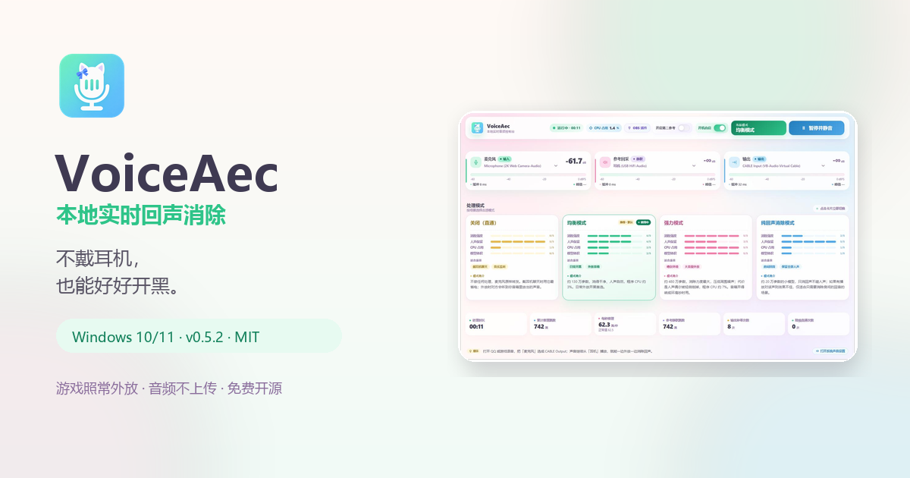
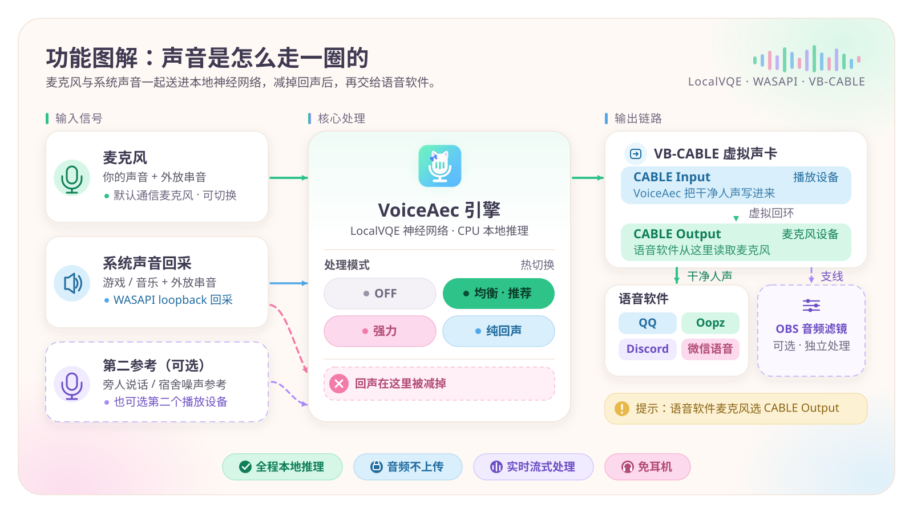
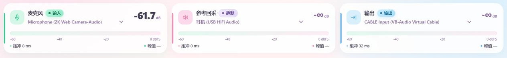
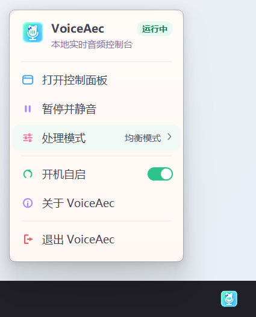
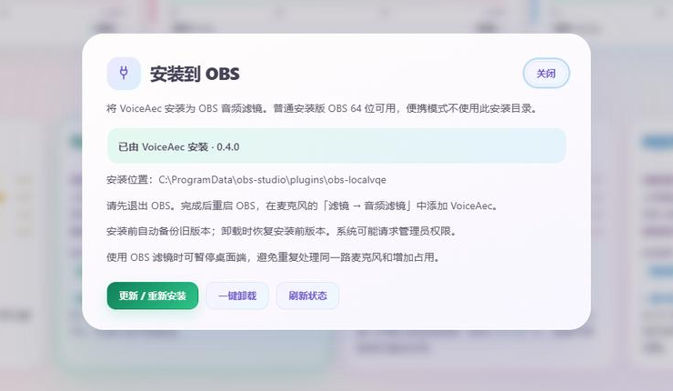
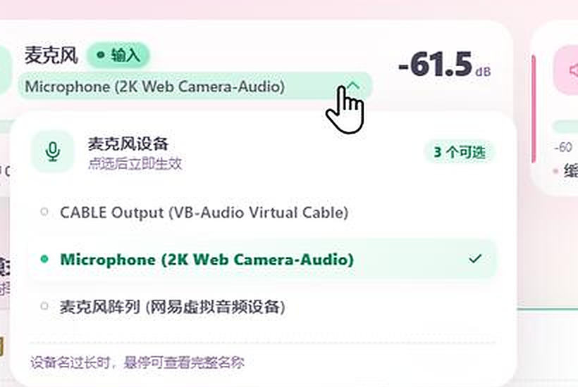
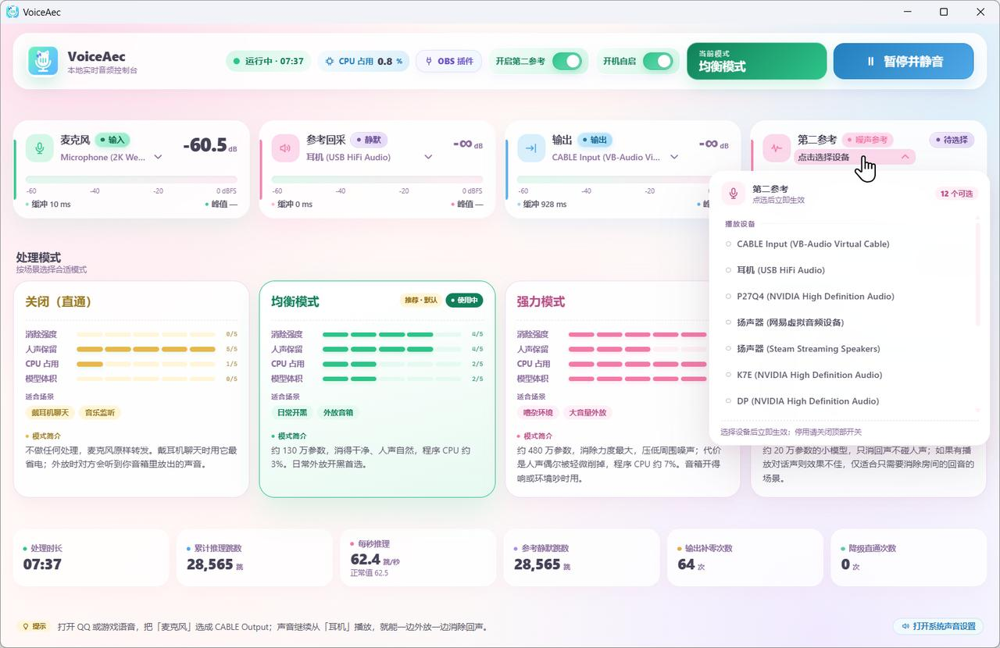
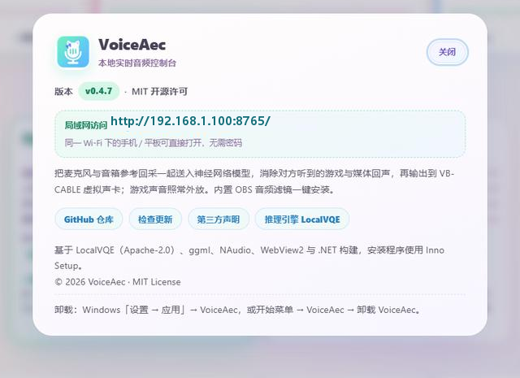

<div align="center">


<h1>VoiceAec</h1>

<p><b>不戴耳机，也能好好开黑。</b></p>

<p>Windows 上的本地实时回声消除（AEC）：游戏和队友语音照常从音箱外放，<br>
VoiceAec 在本机把这些声音从麦克风里减掉，队友听到的主要是你说话。</p>

<p>
  <a href="https://github.com/384615666/VoiceAec/releases/latest"></a>
  <a href="https://github.com/384615666/VoiceAec/releases"></a>
  <a href="LICENSE"></a>
  
  
  <a href="https://voiceaec.lsjx.xyz/"></a>
</p>

<p>
  <a href="https://voiceaec.lsjx.xyz/">🌐 官网</a> ·
  <a href="https://voiceaec.lsjx.xyz/manual.html">📖 图文手册</a> ·
  <a href="https://github.com/384615666/VoiceAec/releases/latest">⬇️ 下载最新版</a> ·
  <a href="#obs-插件一键安装">🎛 OBS 插件</a> ·
  <a href="https://github.com/384615666/VoiceAec/issues">💬 反馈</a> ·
  <a href="README.en.md">English</a>
</p>

</div>

<p align="center">
  
</p>

## 目录

[它解决什么问题](#它解决什么问题) · [功能图解](#功能图解) · [界面一览](#界面一览) · [快速开始](#快速开始) · [处理模式](#处理模式) · [OBS 插件一键安装](#obs-插件一键安装) · [功能一览](#功能一览) · [进阶玩法](#进阶玩法) · [从源码构建](#从源码构建) · [项目结构](#项目结构) · [近期更新](#近期更新) · [常见问题](#常见问题) · [已知限制](#已知限制) · [许可与致谢](#许可与致谢)

## 它解决什么问题

外放打游戏时，麦克风会把游戏声、音乐和其他人说话的声音一起收进去——队友听到的是「二次混音」，轻则吵闹，重则完全听不清你在说什么。要么戴耳机，要么把游戏静音。

VoiceAec 用 [LocalVQE](https://github.com/localai-org/LocalVQE) 神经网络做声学回声消除（AEC）：把当前播放设备的声音回采作为参考信号，从麦克风里把它减掉，再通过 VB-CABLE 虚拟声卡送给 QQ / Oopz / Discord / 游戏语音。

- 🎧 **免耳机**：游戏声音照常外放，语音里听不到回声
- 🔒 **纯本地**：模型推理全部在本机 CPU 上完成，不联网、音频不上传
- 📦 **开箱即用**：发布包自包含（免 .NET 运行时、含全部模型），首次启动自动选设备
- 🎛 **两种形态**：桌面控制面板，以及可一键安装的 OBS 音频滤镜

## 功能图解



1. 麦克风采集你的声音，同时也收进外放声音的串音；
2. 系统声音回采（WASAPI loopback）提供参考信号，神经网络据此把串音从麦克风里减掉；
3. 处理后的干净人声写入 VB-CABLE 虚拟声卡，语音软件把 `CABLE Output` 当作麦克风；
4. 电脑的播放设备仍然是你的音箱或耳机，游戏照常外放——整个过程不经过网络。

## 界面一览

主面板一屏容纳全部常用操作：顶栏状态与开关、三张电平卡、四种处理模式、运行统计。

<p align="center">
  
</p>

**电平三卡**分别是麦克风、参考回采和输出，-60～0 dBFS 渐变条 + 峰值保持；参考卡会显示「播放中 / 静默」，方便确认参考信号是否正常。

<p align="center">
  
</p>

底栏的**运行统计**用来判断参考信号和处理状态是否正常：处理时长、累计推理跳数、每秒推理（正常约 62.5 跳/秒）、参考静默跳数、输出补零次数与降级直通次数。

<p align="center">
  
</p>

关闭窗口只会隐藏到托盘，音频不中断；托盘菜单可以快速打开面板、暂停并静音、切换处理模式、开机自启或退出。

| 托盘菜单（马卡龙风自绘） | OBS 插件管理 |
| :---: | :---: |
|  |  |

## 快速开始

**系统要求**：Windows 10/11 64 位（不支持 32 位、macOS、Linux）；WebView2 运行时（一般系统自带）；一只麦克风和一个耳机/音箱；[VB-CABLE](https://vb-audio.com/Cable/) 虚拟声卡（安装包自带，安装向导可代装）。最新版本号见上方 release 徽章或 [Releases](https://github.com/384615666/VoiceAec/releases) 页面。

### 1. 下载安装

到 [Releases](https://github.com/384615666/VoiceAec/releases/latest) 下载（自包含，免 .NET 运行时，含全部模型）：

| 包 | 适合 |
| --- | --- |
| `VoiceAec-v*-setup-x64.exe` | **推荐**。每用户安装，安装过程只有 VB-CABLE 和局域网配置会请求一次管理员授权；自动创建开始菜单/桌面快捷方式，可在「设置 → 应用」里卸载。 |
| `VoiceAec-v*-win-x64.zip` | 便携版。解压即可用，配置写在 exe 旁 `voiceaec.json`，适合放 U 盘或绿色使用。 |

> 两个包功能一致；安装版和便携版不要同时运行（单实例会互相激活）。

### 2. 装好虚拟声卡

VoiceAec 需要一个虚拟声卡把处理后的声音送进语音软件，推荐免费的 [VB-Audio Virtual Cable](https://vb-audio.com/Cable/)：

- **安装版**：安装向导默认勾选 VB-CABLE，取消勾选可跳过；
- **便携版**：首次启动面板顶部会出现引导条，点「一键安装虚拟声卡」即可；
- 装完**必须重启电脑**，「播放设备」里才会出现 `CABLE Input`，「录音设备」里才会出现 `CABLE Output`。

### 3. 对上四个设备

| 位置 | 选择 |
| --- | --- |
| Windows 播放设备（游戏/音乐） | 你的音箱或耳机 |
| VoiceAec · 参考回采 | 正在出声的播放设备（自动选中） |
| VoiceAec · 输出 | `CABLE Input`（自动选中） |
| 语音软件（QQ / Oopz / Discord）麦克风 | `CABLE Output` |

一句话记住：**VoiceAec 把干净的声音放进 `CABLE Input`，语音软件从 `CABLE Output` 把它当麦克风拿走。**

设备不对时，直接点面板上电平卡里的设备名，在下拉里换一个即可——热切换不停引擎，选择会被记住。

<p align="center">
  
</p>

### 4. 开黑

打开面板 → 确认顶栏显示「运行中」→ 模式保持默认的「均衡模式」→ 说句话，看麦克风电平是否跳动。可选：顶栏打开「开机自启」，或到下一节安装 OBS 插件。

> ⚠️ 找不到 `CABLE Input` 时，程序会以暂停状态打开，不会把麦克风直接播到音箱（避免意外的监听和啸叫）；装好虚拟声卡后点「重新检测」或重启即可。

## 处理模式

| 模式 | 特点 | 程序 CPU | 适合 |
| --- | --- | --- | --- |
| **关闭（直通）** | 不处理，最省电；外放串音会全部传给对方 | 最低 | 戴耳机、临时旁路 |
| **均衡模式 v1.2** | 推荐默认，消除与音质平衡 | 约 3% | 日常开黑、直播 |
| **强力模式 v1.3** | 消除最彻底，可能轻微削人声 | 约 7% | 宿舍、网吧等嘈杂环境 |
| **纯回声消除模式 v1.4** | 只处理回声，尽量不动其他声音 | 低 | 房间回音、近场麦克风 |

<p align="center">
  
</p>

> CPU 只统计 VoiceAec 进程、按整机 CPU 折算（与任务管理器口径一致），数字来自原测试机器，不同 CPU 差异较大；面板顶栏会实时显示当前占用。模式可以在面板或托盘随时热切换，切换后会被记住。纯回声消除模式在麦克风离得远时效果有限，建议先试听再长期使用。

## OBS 插件一键安装

OBS 里也能直接使用同一个模型：面板顶栏点「OBS 插件」打开管理窗口。

1. **退出 OBS**，点击「一键安装到 OBS」，按系统提示授予管理员权限；
2. 安装器会把插件、模型和依赖装到 `%ProgramData%\obs-studio\plugins\obs-localvqe`，已有版本先备份到 `%ProgramData%\VoiceAec\ObsPlugin\backups\<id>\previous`；
3. 重启 OBS，在麦克风的「滤镜 → 音频滤镜」里添加 **VoiceAec**，并在滤镜属性的 **Reference source** 里选择桌面音频/游戏音频源——不选就只做降噪/去混响，不做回声消除；
4. 插件独立工作；同时开着桌面端时，可以暂停桌面端避免同一只麦克风被重复处理。

「一键卸载」会移除本程序安装的版本，如果安装前已有插件则恢复备份；后来新增的模型、配置和外部改动文件会保留。

> 限制：仅支持普通安装版 OBS 64 位（便携版 OBS 不扫描标准插件目录）；OBS 运行中禁止安装/卸载，安装器不会替你关闭 OBS；需要管理员权限，拒绝 UAC 会失败。插件版本号与桌面端独立（当前桌面端 v0.5.3，插件为 0.4.0），弹窗显示的是插件版本。

## 功能一览

| 能力 | 说明 |
| --- | --- |
| 🎚 三路电平 | 麦克风 / 参考回采 / 输出，-60～0 dBFS 渐变条 + 峰值保持 |
| 🧠 四模式热切换 | 关闭（直通）、均衡模式 v1.2、强力模式 v1.3、纯回声消除模式 v1.4，切换即生效并记住 |
| 🎙 第二参考（进阶） | 可选第二只麦克风放在旁人/噪声源附近，削弱网吧、宿舍里其他人的说话声 |
| 🔌 设备自动适配 | 首次启动自动选默认通信麦克风、默认播放设备和 `CABLE Input` |
| 🛟 设备缺失回退 | 保存的设备被拔掉时自动回退到系统默认并在底栏提示，原选择不被覆盖 |
| ⏸ 暂停并静音 | 停止采集、推理与输出；恢复时清空旧音频并重置模型状态 |
| 🚀 开机自启 | 写入 HKCU Run，开机以 `--tray` 静默后台运行 |
| 🪟 托盘常驻 | 关窗只隐藏；托盘左键打开面板，右键菜单切换模式/自启/退出 |
| 📐 窗口记忆 | 关闭或退出时记住窗口位置与尺寸（副屏也适用） |
| 🌐 局域网面板 | 同一 Wi-Fi 下手机/平板打开「关于」里显示的 `http://192.168.x.x:8765/` 看电平、切模式（端口占用时会自动顺延，以「关于」为准）；可用 `--no-lan` 关闭 |
| 🧩 OBS 插件 | 面板内一键安装/卸载，带备份与回滚 |
| 📊 运行统计 | 处理时长、累计推理跳数、每秒推理（正常约 62.5 跳/秒）、参考静默跳数、输出补零次数、降级直通次数 |
| 🛡 健壮性 | 无设备/无虚拟声卡时以暂停状态打开；重复启动只激活已有实例；高 DPI 使用 PerMonitorV2 |
| 🔐 本地 API | `http://localhost:8765`（端口占用自动 +1 到 8774）；回环始终可用，局域网模式额外允许本机私有网段，`X-VoiceAec-Token` 鉴权 |

## 进阶玩法

<details>
<summary><b>第二参考：削弱网吧 / 宿舍里旁人的说话声</b></summary>

把第二只麦克风放在旁人/噪声源附近，或者选第二个播放设备，作为额外的噪声参考。建议配合「强力模式 v1.3」使用；如果发现自己的声音被削，换回「均衡模式 v1.2」或关闭第二参考。

<p align="center">
  
</p>

</details>

<details>
<summary><b>局域网控制面板</b></summary>

面板默认对同一 Wi-Fi / 局域网开放（仅私有网段、无密码），「关于」里会显示 `http://192.168.x.x:8765/`（端口被占用时会自动顺延，以「关于」为准）。安装版会自动注册 URL ACL 和防火墙规则；便携版没有安装器，不会自动配置这些规则，可以改用安装版，或加 `--no-lan` 只用本机面板。

<p align="center">
  
</p>

> ⚠️ 面板没有登录密码，只适合可信的家庭网络。不要在公共 Wi-Fi 或宾馆共享网络长期开启，也不要把端口转发到公网。

</details>

<details>
<summary><b>HTTP API</b></summary>

所有 `/api/*` 请求需要请求头 `X-VoiceAec-Token`（面板会自动携带当前会话令牌）。端口默认 `8765`，被占用时自动 +1 到 `8774`。

访问策略：回环地址始终可用；开启局域网面板时额外允许本机私有网段访问；跨站请求和 DNS rebinding 会被拒绝，不返回 CORS 头。

| 方法 | 路径 | 说明 |
| --- | --- | --- |
| GET | `/api/status` | 全量状态 JSON（版本、模式、CPU、电平、统计、设备、`autostart`、`cableMissing`、`lanUrl` 等） |
| GET | `/api/devices` | 枚举设备、当前选择与 `ref2Choices` |
| POST | `/api/devices` | JSON `{mic\|ref\|ref2\|out: "设备名"}`，热切换并持久化 |
| POST | `/api/model` | 纯文本 `off` / `v1.2` / `v1.3` / `v1.4` |
| POST | `/api/autostart` | 纯文本 `true` / `1` / `on` 或 `false` / `0` / `off` |
| POST | `/api/pause` | 纯文本 `true` 暂停并静音，`false` 恢复；失败保持静音 |
| POST | `/api/recheck` | 按保存的设备名重新检测并绑定（v0.5.2 新增） |
| POST | `/api/sound-settings` | 打开 Windows「设置 → 系统 → 声音」 |
| GET/POST | `/api/vbcable/install` | 查询/启动虚拟声卡的异步安装（202 表示进行中） |
| GET | `/api/obs-plugin` | 插件安装状态、OBS 是否运行及最近任务结果 |
| POST | `/api/obs-plugin/install` / `uninstall` | 异步安装/卸载，返回 202 |
| POST | `/api/quit` | 退出进程（调试用） |

</details>

<details>
<summary><b>命令行参数</b></summary>

| 参数 | 默认 | 说明 |
| --- | --- | --- |
| `--mic` | 系统默认通信麦克风 | 麦克风设备（子串匹配，优先级高于配置文件） |
| `--ref` | 系统默认播放设备 | 参考回采设备（也可填麦克风，近讲场景） |
| `--ref2` | `none` | 第二参考；找不到时自动降级为单参考 |
| `--out` | `CABLE Input` | 输出设备；缺 CABLE 时回退并进入暂停保护 |
| `--threads` | `2` | 推理线程数 |
| `--model` | 配置中的模式，否则 `v1.2` | `off` / `v1.2` / `v1.3` / `v1.4`，仅本次启动生效 |
| `--port` | `8765` | HTTP 端口（占用时自动 +1 到 8774） |
| `--tray` | — | 静默托盘启动（开机自启用） |
| `--start-paused` | — | 启动即暂停（等同配置 `paused=1`） |
| `--console` | — | 调试：保留日志控制台 |
| `--list` | — | 列出音频设备后退出 |
| `--no-lan` | — | 只监听本机，不对局域网开放面板 |

设备名都是不区分大小写的子串匹配；`--mic` / `--ref` / `--ref2` / `--out` 优先于配置文件，解析到的真实设备会像面板选择一样保存到 `voiceaec.json`。`--model` 只影响本次启动，不写回配置。

</details>

<details>
<summary><b>配置文件与数据目录</b></summary>

设备选择、处理模式、暂停状态、窗口位置都保存在 `voiceaec.json`：

- **安装版**：`%LocalAppData%\Programs\VoiceAec\voiceaec.json`；
- **便携版**：优先放在 exe 旁；如果 `%LocalAppData%\VoiceAec\voiceaec.json` 已存在则优先用它，exe 旁不可写时也会回退到该路径；
- 一般不需要手动修改；配置损坏时退出程序后删除该文件即可恢复默认。

</details>

## 从源码构建

```powershell
dotnet build -c Release
```

- TFM `net10.0-windows`（WinForms + WebView2，x64），需要 .NET 10 SDK；NuGet 依赖 NAudio 2.2.1、Microsoft.Web.WebView2 1.0.2903.40；
- 原生依赖需手动放进输出目录 `bin/Release/net10.0-windows/`（csproj 不管理）：`liblocalvqe.dll`、`ggml*.dll`、MSYS2 ucrt64 运行库（`libgcc_s_seh-1.dll`、`libstdc++-6.dll`、`libwinpthread-1.dll`）；
- 模型查找顺序：exe 旁 `models\` → `C:\ProgramData\obs-studio\plugins\obs-localvqe\data`；
- 前端 `wwwroot/index.html` 是单文件零依赖页面，构建时自动拷贝到输出目录。

验证（不启动音频设备）：

```powershell
dotnet run --project tests/VoiceAec.Tests.csproj -c Release
node tests/frontend.test.cjs
```

v0.4.0 的 LocalVQE Windows 补丁在 [native/LocalVQE-windows.patch](native/LocalVQE-windows.patch)，构建说明见 [native/README.md](native/README.md)；v1.4 数值修复记录见 [docs/V14-AEC-NUMERICS.md](docs/V14-AEC-NUMERICS.md)。

<details>
<summary><b>制作整合发布包（OBS 插件 + 桌面端）</b></summary>

```powershell
./tools/Package-Windows.ps1 -OutputDirectory <发布目录> `
  -NativeBin <LocalVQE原生构建bin目录> -PluginDll <新obs-localvqe.dll> `
  -ModelsDirectory <模型目录> -LocaleDirectory <插件locale目录> `
  -RuntimeDirectory <MinGW运行库目录>
```

打包脚本会生成安装清单及 SHA256，并复用桌面包内的模型与原生库。普通 `dotnet publish` 不会自动生成 OBS 资源清单，缺少资源时安装入口会提示使用完整整合包。发布前先用 `tools/fetch_vbcable.py` 准备 `vendor\VBCABLE`（打包脚本不会复制它）；脚本会把当前 `README.md` 一并复制进发布包，包内说明要更新需要重新打包。

</details>

## 项目结构

```
VoiceAec/
├─ Program.cs              # 主程序：音频链路、HTTP 服务、设备与配置
├─ LocalVqe.cs             # LocalVQE 原生推理封装
├─ TrayUi.cs               # 自绘托盘菜单
├─ ObsPluginInstaller.cs   # OBS 插件安装 / 卸载 / 回滚
├─ ObsPluginManager.cs     # 插件状态与 OBS 进程检测
├─ RuntimeSupport.cs       # 单实例互斥、本地 API 访问策略、音频采集与重采样
├─ SampleRing.cs           # 音频环形缓冲
├─ wwwroot/index.html      # 单文件控制面板前端
├─ docs/                   # 官网、图文手册、发布说明、截图
├─ native/                 # LocalVQE Windows 补丁与构建说明
├─ tools/                  # 打包脚本与安装器资源
└─ tests/                  # 后端与前端测试
```

## 近期更新

| 版本 | 亮点 |
| --- | --- |
| **v0.5.3** | 全新项目主页、功能图解与英文概览；截图格式规范化；发布包附带文档素材。功能与 v0.5.2 一致。 |
| **v0.5.2** | 缺虚拟声卡时恢复也会被拦住；明确选择输出后可恢复；提示随状态刷新；新增「重新检测」接口。 |
| **v0.5.0** | 缺 CABLE 保持暂停、无设备不崩溃、临时回退不写回配置、虚拟声卡后台安装、安装器正确判断驱动结果。 |
| **v0.4.9** | 设备拔掉自动回退、记住窗口位置与大小、暂停状态保留、CABLE 改名兼容。 |

完整记录见 [docs/RELEASE-v0.5.3.md](https://github.com/384615666/VoiceAec/blob/main/docs/RELEASE-v0.5.3.md) 与 [全部发布](https://github.com/384615666/VoiceAec/releases)。

## 常见问题

<details>
<summary><b>对方还是能听到游戏声或回声？</b></summary>

按顺序检查三件事：

1. **参考回采选对了吗？** 必须选你实际放声音的耳机/音箱。播放音乐时参考电平应该跳动，状态从「静默」变成「播放中」。如果参考回采选成了 `CABLE Input`，就听不到音箱在放什么，回声也消不掉。
2. **语音软件的扬声器选对了吗？** 保持耳机/音箱，不要选 `CABLE Input`——那会把声音送回虚拟声卡。
3. **模式够不够？** 均衡模式 v1.2 不够就试强力模式 v1.3；音量别开到削波，麦克风离嘴近一点。

如果参考回采一直是静默的，AEC 没有参考信号，换什么模式都没用。

</details>

<details>
<summary><b>对方说我声音变小 / 断续 / 像机器人？</b></summary>

先看底部「每秒推理」：正常约 62.5 跳/秒，低于 55 会变红，通常是 CPU 跟不上。

- 把模式从强力模式 v1.3 换回均衡模式 v1.2，或关掉第二参考；
- 关闭占 CPU 的后台程序，笔记本插电并开高性能模式；
- 「输出补零次数」快速上涨说明输出卡顿，换一个输出设备或重启 VoiceAec；
- 蓝牙耳机的麦克风常切到低音质通话模式，尽量用有线/USB 麦克风；麦克风增益别开太大，峰值长期顶到 0 dB 会削波。

</details>

<details>
<summary><b>对方完全听不到我？</b></summary>

沿链路从后往前查：语音软件麦克风是否为 `CABLE Output` → VoiceAec 输出是否为 `CABLE Input`（说话时输出电平是否跳动）→ 是否点了「暂停并静音」（顶栏应显示「运行中」）→ Windows 麦克风隐私设置是否允许桌面应用访问 → 麦克风是否被 OBS、相机等程序独占。

</details>

<details>
<summary><b>语音软件里找不到 CABLE Output？</b></summary>

装完 VB-CABLE 必须重启电脑。「播放设备」里应出现 `CABLE Input`，「录音设备」里应出现 `CABLE Output`。没有的话重新运行 VoiceAec 安装包并保留「安装 VB-CABLE」勾选，或在面板顶部引导条点「一键安装虚拟声卡」；仍然没有就检查设备管理器里是否有未知设备。

</details>

<details>
<summary><b>QQ 提示 CABLE Output 加载失败？</b></summary>

这是 QQ 侧对虚拟设备打开方式的兼容问题，音频链路本身通常正常。可以尝试：在 QQ 语音设置里重新选择一次 `CABLE Output`；重启 QQ；或者用 Oopz、Discord、游戏自带语音验证链路。

</details>

<details>
<summary><b>会有延迟吗？</b></summary>

AEC 需要缓冲，几十毫秒级延迟是正常的，语音聊天一般感觉不到；不适合专业实时乐器监听。如果声音变调或明显断续，检查 Windows 声音设置里 `CABLE Input` / `CABLE Output` 的格式是否统一为 48000 Hz，关闭占用音频设备的程序，或换回均衡模式再试。

</details>

<details>
<summary><b>音频会上传吗？需要联网吗？</b></summary>

不会。模型推理完全在本机 CPU 上，正常使用不需要联网；唯一的网络功能是可选的局域网面板，而且默认只对私有网段开放。

</details>

<details>
<summary><b>怎么升级 / 卸载？</b></summary>

升级：直接运行新版安装包，安装器会结束旧实例，设备配置保留。卸载：Windows「设置 → 应用 → 已安装的应用」里卸载，或开始菜单里卸载 VoiceAec。卸载不会移除 VB-CABLE；安装目录里的 `voiceaec.json` 会删除，曾回退到 `%LocalAppData%\VoiceAec\voiceaec.json` 的可能会保留，可手动删除。

</details>

<details>
<summary><b>杀毒软件 / SmartScreen 拦截安装包？</b></summary>

安装包没有购买商业代码签名，新项目容易被误报。先在 GitHub Releases 核对文件名和 SHA256（见对应发布说明），确认来源无误再决定是否放行；不要为了安装整体关闭杀毒软件。

</details>

## 已知限制

- **麦克风独占**：麦克风同一时刻只能被一个程序打开，和 OBS 互斥；两者都要用同一只麦克风时，可查阅上游 [LocalVQE](https://github.com/localai-org/LocalVQE) 仓库关于多程序共享麦克风的讨论。
- **QQ + CABLE Output**：QQ 对虚拟设备的打开方式偶发「加载失败」，属于 QQ 侧问题，音频链路本身已验证正常。
- **延迟与用途**：AEC 需要缓冲，几十毫秒级延迟是正常的；语音聊天一般感觉不到，但不适合专业实时乐器监听。
- **第二参考不是万能降噪**：需要第二只麦克风真的靠近噪声源；没有旁人噪声时长期开启，可能反而削弱自己的人声。
- **无代码签名**：安装包没有购买商业代码签名，SmartScreen 可能提示「未知发布者」；请先核对文件名与 SHA256。
- **仅 Windows x64**：Windows 10/11 64 位；依赖 WebView2 运行时（一般系统自带）。
- **OBS 一键安装**：只支持普通安装版 OBS 64 位，便携版 OBS 不适用。
- **局域网面板无密码**：只适合可信网络，不要暴露到公网。

## 许可与致谢

应用代码以 [MIT](LICENSE) 授权；发布包内的第三方组件（推理引擎、模型、ggml、运行库等）见 [THIRD-PARTY-NOTICES.md](THIRD-PARTY-NOTICES.md)。

- [LocalVQE](https://github.com/localai-org/LocalVQE) — 上游回声消除模型与推理库
- [ggml](https://github.com/ggml-org/ggml) — CPU 推理后端
- [VB-Audio Virtual Cable](https://vb-audio.com/Cable/) — 虚拟声卡
- [Microsoft WebView2](https://learn.microsoft.com/microsoft-edge/webview2/) · [NAudio](https://github.com/naudio/NAudio) — 面板承载与音频采集

<div align="center">
<br>

如果 VoiceAec 让开黑舒服了一点，欢迎点一颗 ⭐ Star，或者把[图文手册](https://voiceaec.lsjx.xyz/manual.html)分享给被回声困扰的朋友。

</div>
