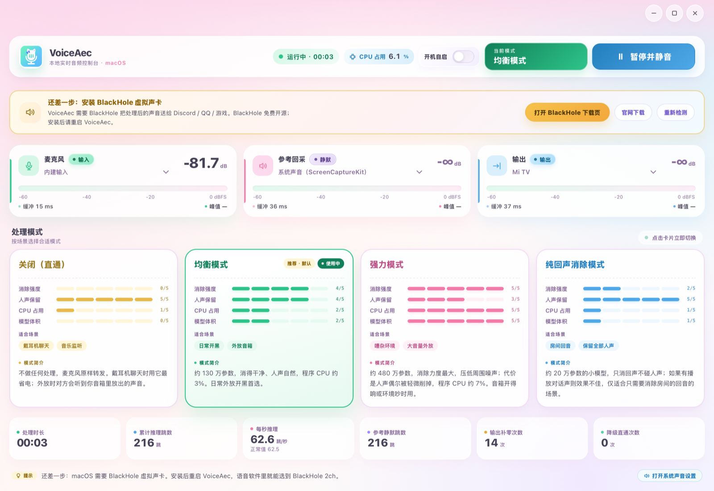

# VoiceAec for macOS

VoiceAec 的 macOS 原生版本：保留同一套网页面板与 LocalVQE 回声消除引擎，把 Windows 的
WASAPI / VB-CABLE / WinForms 外壳替换为 CoreAudio / ScreenCaptureKit / BlackHole / AppKit。

<p align="center">
  
</p>

> 状态：可运行的开发版（v0.6.3-mac）。已在 macOS 15.8 / Intel x86_64 上构建、启动、跑通
> 麦克风采集、ScreenCaptureKit 系统声音回采、LocalVQE 推理和本地 HTTP 面板；Apple Silicon
> 使用同一份通用二进制，但本机没有 arm64 硬件，未做真机验证。OBS 插件尚未移植。

## 它和 Windows 版有什么不同

| 能力 | Windows 版 | macOS 版 |
|---|---|---|
| 界面 | WinForms + WebView2 + 托盘 | AppKit 菜单栏 + WKWebView，复用同一份面板 |
| 麦克风 | WASAPI | CoreAudio AUHAL（原生采样率 + AVAudioConverter 重采样到 16 kHz） |
| 系统声音回采 | WASAPI loopback | ScreenCaptureKit（需要「屏幕录制」权限） |
| 虚拟麦克风 | VB-CABLE | [BlackHole 2ch](https://existential.audio/blackhole/)（用户安装；不随包分发） |
| 推理 | LocalVQE C API + ggml（Windows DLL） | 同一 C API，编译为通用 `liblocalvqe.dylib` |
| 托盘 | WinForms NotifyIcon | `NSStatusItem` 菜单栏 |
| 开机自启 | 注册表 Run | `SMAppService`（登录项） |
| OBS 插件 | 一键安装 | 暂未提供 |
| 安装包 | Inno Setup + 便携 zip | `.app` + 可选 zip（ad-hoc 签名，未公证） |
| 架构 | x64 | x86_64 + arm64 通用二进制 |

## 系统要求

- macOS 13 Ventura 或更高版本（ScreenCaptureKit 音频回采需要 13+）。
- 一只麦克风、一个扬声器/耳机（和 Windows 版一样，外放时效果最好）。
- [BlackHole 2ch](https://existential.audio/blackhole/) 虚拟声卡：用于把处理后的声音送进
  Discord / QQ / 游戏语音。
- Intel 与 Apple Silicon 均可；发布包是通用二进制。

## 快速开始

### 1. 安装 BlackHole

macOS 没有 Windows 的 VB-CABLE，也没有系统级的 loopback 输出。VoiceAec 用 BlackHole 作为
「虚拟麦克风」：

1. 打开 <https://existential.audio/blackhole/>，下载 **BlackHole 2ch**（不要装 16ch/64ch）。
2. 运行安装器（需要管理员密码），安装完**重启电脑**（或至少重新登录）。
3. 打开「音频 MIDI 设置」确认能看到 `BlackHole 2ch`。

VoiceAec 不捆绑 BlackHole：它是 GPL-3.0 的独立驱动，安装需要管理员权限，且应该由用户
自行决定是否安装。VoiceAec 只检测它，并在面板里给出下载入口。

### 2. 安装并打开 VoiceAec

推荐用 **DMG 安装版**：双击 `VoiceAec-0.6.3-macOS-universal.dmg`，把 `VoiceAec.app` 拖进
「应用程序」，然后双击打开。也可以双击 `VoiceAec-0.6.3-macOS-universal.pkg`，按提示安装
到 `/Applications`。

> 两个安装介质里的 App 都是 ad-hoc 签名的开发版，未做 Apple 公证。DMG 更推荐；PKG 是
> 未签名包，Gatekeeper 可能要求到「系统设置 → 隐私与安全性」里点「仍要打开」。
> 如果提示「已损坏」，见下文。

第一次启动会依次请求两个权限：

1. **麦克风**：必须允许，否则无法消除回声。对话框出现时引擎会先等待你选择，避免和
   CoreAudio 守护进程抢锁；点「允许」后开始处理。
2. **屏幕录制**：macOS 用这个权限采集系统声音作为 AEC 参考信号（不是录屏）。
   在「系统设置 → 隐私与安全性 → 屏幕录制」中勾选 VoiceAec；如果刚才点了不允许，
   勾选后需要退出并重新打开 VoiceAec。

> 这是 ad-hoc 签名的开发版：每次重新构建/重新签名后，macOS 会把应用当成新程序，需要重新授权。

如果提示「VoiceAec 已损坏」或无法打开：

```bash
xattr -dr com.apple.quarantine /Applications/VoiceAec.app
open /Applications/VoiceAec.app
```

或者右键点击 App →「打开」→ 再点「打开」。

### 3. 对上四个设备

| 位置 | 选择 |
|---|---|
| macOS 声音输出（游戏/音乐） | 你的扬声器或耳机 |
| VoiceAec · 麦克风 | 你的真实麦克风（默认已选） |
| VoiceAec · 参考回采 | 固定为「系统声音（ScreenCaptureKit）」，无需选择 |
| VoiceAec · 输出 | `BlackHole 2ch`（检测到后会自动选中） |
| Discord / QQ / 游戏语音的麦克风 | `BlackHole 2ch` |

一句话：**VoiceAec 把干净的声音写进 BlackHole，语音软件从 BlackHole 把它当麦克风读走。**

如果输出不是 BlackHole，面板会提示「处理后的声音不会进入语音软件」；在「输出」卡片里
点设备名切换即可，选择会记住。装好 BlackHole 并重启 VoiceAec 后会自动选中它；只有你手动
选过其它输出时才会尊重你的选择。

还没装 BlackHole 时，VoiceAec **不会**把麦克风直接播到扬声器（避免啸叫），输出会显示
「未找到设备」；装好 BlackHole 后，程序运行中也会自动检测并切换。

### 4. 开黑

打开面板 → 确认顶栏「运行中」→ 模式保持「均衡模式」→ 说句话，看麦克风电平是否跳动。
参考回采卡片在播放音乐/游戏声音时应显示「使用中」和电平；如果一直是「静默」，检查屏幕
录制权限。

## 菜单栏

关闭窗口只会隐藏到菜单栏，音频不中断。菜单栏图标提供：

- 打开面板
- 暂停并静音 / 恢复处理与输出
- 处理模式（关闭 / 均衡 / 强力 / 纯回声消除）
- 输出设备（含 BlackHole）
- 重新检测设备
- 屏幕录制权限…
- 开机自启
- 打开日志文件夹
- 关于 / 退出

## 处理模式

与 Windows 版一致：

| 模式 | 模型 | 说明 |
|---|---|---|
| 关闭（直通） | — | 麦克风原样输出，最省电 |
| 均衡模式 | v1.2 (1.3M) | 默认，日常开黑 |
| 强力模式 | v1.3 (4.8M) | 消除更狠，CPU 更高 |
| 纯回声消除模式 | v1.4-AEC (200K) | 只消回声，保留人声和房间感 |

模型查找顺序：App 内 `Contents/Resources/models/` → `~/Library/Application Support/VoiceAec/models/`
→ 当前目录 `models/`。把任意 GGUF 放进这两个目录即可替换。

## 从源码构建

### 依赖

- macOS 13+，Xcode Command Line Tools（`xcode-select --install`）
- Swift 5.9+（CLT 自带）
- CMake 与 Ninja：`brew install cmake ninja`
- `curl`、`python3`（构建脚本与工具用）
- 首次构建需要联网下载 LocalVQE 源码和模型

### 一条命令

```bash
# 构建 LocalVQE 通用 dylib（首次，约 2–4 分钟）
./macos/scripts/build-localvqe.sh

# 下载三个 GGUF 模型（约 26 MB；默认走 hf-mirror，可用 HF_ENDPOINT 覆盖）
./macos/scripts/fetch-models.sh

# 构建通用 VoiceAec.app（Intel + Apple Silicon）
./macos/build.sh

# 同时生成可分发 zip 和安装介质（DMG + PKG）
ZIP=1 INSTALLER=1 ./macos/build.sh

# 也可以单独打安装包（需要先有 dist/VoiceAec.app）
./macos/scripts/build-installer.sh
```

产物：

- `dist/VoiceAec.app`
- `dist/VoiceAec-macOS-universal.zip`（`ZIP=1`）
- `dist/VoiceAec-0.6.3-macOS-universal.dmg`（`INSTALLER=1`，推荐分发）
- `dist/VoiceAec-0.6.3-macOS-universal.pkg`（`INSTALLER=1`，未签名开发包）

DMG 内含 App、`Applications` 快捷方式、安装说明、完整 README 和 BlackHole 下载链接。

脚本会在仓库内使用 `.build-*`、`.cache`、`.tmp`，不会写系统缓存。

### 开发调试

```bash
CONFIG=debug UNIVERSAL=0 ./macos/build.sh
open dist/VoiceAec.app

# 自检（环形缓冲、配置迁移、模型加载与推理；不需要麦克风权限）
./macos/scripts/self-test.sh

# 查看面板 API（token 从 HTML 里自动提取）
./macos/scripts/status.sh
```

`VOICEAEC_SNAPSHOT=/tmp/panel.png ./dist/VoiceAec.app/Contents/MacOS/VoiceAec` 可在启动
4 秒后把 WKWebView 面板截图为 PNG，方便在无头环境检查 UI。

### 签名与公证

默认使用 ad-hoc 签名（`codesign --sign -`）。要分发：

```bash
CODESIGN_IDENTITY="Developer ID Application: Your Name (TEAMID)" \
  ZIP=1 ./macos/build.sh

xcrun notarytool submit dist/VoiceAec-macOS-universal.zip \
  --apple-id you@example.com --team-id TEAMID --password app-specific-password --wait
xcrun stapler staple dist/VoiceAec.app
```

`macos/Resources/VoiceAec.entitlements` 包含麦克风与
`com.apple.security.cs.disable-library-validation`（用于加载随包的 LocalVQE dylib）。
App 未启用 App Sandbox。

## 架构

```
                   ┌──────────────────────────────┐
 麦克风 ── AUHAL ──▶│ 原生率 44.1/48 kHz → AVAudioConverter → 16 kHz mono │──┐
                   └──────────────────────────────┘                  │
                                                                     ▼
 系统声音 ── ScreenCaptureKit ──▶ 48 kHz → 16 kHz mono ──▶ 参考环形缓冲 ──▶ LocalVQE (256 hop)
                                                                     │
                   ┌──────────────────────────────┐                  │
 BlackHole ◀─ AUHAL │ 16 kHz → 设备原生率（HAL 负责 SRC） │◀── 输出环形缓冲 ◀──┘
                   └──────────────────────────────┘
```

- **进程模型**：单个 `.app` 进程，AppKit + WKWebView + CoreAudio + ScreenCaptureKit；
  没有 helper 进程，权限归属清晰。
- **面板**：本地 HTTP 服务绑定 `127.0.0.1:8765`（冲突时自动换端口），页面和 API 都要求
  随机 token；只监听回环地址，不开放局域网。
- **推理**：`liblocalvqe.dylib` 是 x86_64 + arm64 通用二进制，只链接系统框架；模型通过
  C API 加载，256 样本/hop，16 kHz。
- **实时性**：音频回调只做拷贝/重采样，DSP 在独立线程按 16 ms hop 处理；环形缓冲有上限，
  过载时丢弃最旧样本，避免延迟无限增长。
- **单实例**：`~/Library/Application Support/VoiceAec/instance.lock` 的 `flock` 防止两个
  实例同时写 BlackHole。

## 目录

```
macos/
  Package.swift                  SwiftPM 工程
  Sources/
    CLocalVQE/                   LocalVQE C 头文件桥接
    VoiceAecCore/                配置、CoreAudio、SCK、推理、HTTP API
    VoiceAec/                    AppKit 菜单栏 + 窗口 + WKWebView
    VoiceAecSelfTest/            无 XCTest 的自检程序
  Resources/                     Info.plist、entitlements、图标、macOS 面板适配
  Vendor/                        liblocalvqe.dylib、models/（构建产物，gitignore）
  scripts/                       build-localvqe / fetch-models / self-test / status
  build.sh                       打包 .app + 签名
```

## 已知限制与后续

- **OBS 插件**：Windows 版有 `obs-localvqe` 滤镜；macOS 的 OBS 插件需要单独编译
  `.plugin`/`.so` 并适配 OBS 的 macOS 音频 API，当前版本隐藏了该入口。
- **参考信号延迟**：ScreenCaptureKit 的管道延迟与麦克风采集延迟不完全一致。当前按
  16 kHz 样本对齐消费，未做自动延迟估计；如果实际回声消除效果不理想，可在后续版本加入
  cross-correlation 对齐或可调参考延迟。
- **虚拟声卡自动安装**：BlackHole 是内核扩展式音频驱动，安装需要管理员权限；当前只检测
  并提供下载入口，不会静默安装。
- **开机自启**：使用 `SMAppService`，App 需要放在 `/Applications`；首次开启可能还需要在
  「系统设置 → 通用 → 登录项」里批准。
- **未公证**：源码构建默认 ad-hoc 签名；正式分发需要 Developer ID + 公证。
- **第二参考 / 固定默认麦克风**：macOS 版暂未实现，面板中已隐藏。
- **局域网面板**：macOS 版只监听回环地址，未开放手机访问。

## 故障排查

**面板一直「正在连接」**
- 看 `~/Library/Application Support/VoiceAec/VoiceAec.log`。
- 端口 8765 是否被占用；应用会自动换端口，但浏览器/面板始终用实际端口。
- 第一次启动的麦克风权限对话框是否还没点？未授权前引擎不会启动，避免和 coreaudiod 抢锁。

**没有声音 / 参考回采静默**
- 系统设置 → 隐私与安全性 → 屏幕录制：勾选 VoiceAec，退出重开。
- 播放一段音乐，参考卡电平应跳动；`/api/status` 里 `ref.active=true`。
- 如果 `refError` 非空，菜单栏「重新检测设备」或重启 App。

**语音软件听不到**
- VoiceAec 输出必须是 `BlackHole 2ch`；语音软件麦克风也必须是 `BlackHole 2ch`。
- 面板「输出」卡片显示的不是 BlackHole 时会有提示。
- BlackHole 装完要重启；在「音频 MIDI 设置」里确认设备存在。

**回声没消掉**
- 先确认参考回采在播放时是「使用中」，不是「静默」。
- 提高麦克风/扬声器音量，或换「强力模式」。
- 扬声器离麦克风太近、房间混响太重时，任何 AEC 都会吃力；可先用耳机对比。

**重新构建后权限又没了**
- ad-hoc 签名的 cdhash 变了，TCC 视为新应用；重新授权即可。正式签名/公证后不会这样。

**重置设置**
- 菜单栏 →「恢复默认设置…」，确认后 VoiceAec 会退出；下次启动即为默认配置
  （语言中文、均衡模式、未手动选择输出）。

**日志**
- `~/Library/Application Support/VoiceAec/VoiceAec.log`
- 配置：同目录 `config.json`
- 菜单栏「打开日志文件夹」可直接打开。

## 许可

VoiceAec 应用代码：MIT。LocalVQE 与模型：Apache-2.0；ggml：MIT。BlackHole 是 GPL-3.0，
不随 VoiceAec 分发，用户从官网自行安装。详见仓库根目录
[THIRD-PARTY-NOTICES.md](../THIRD-PARTY-NOTICES.md)。
